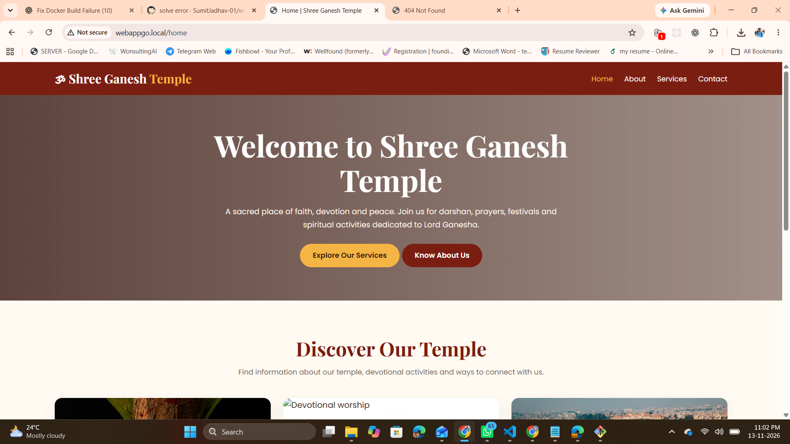

# 🛕 Shree Ganesh Temple Website

A simple and elegant multi-page website for Shree Ganesh Temple, designed to present temple information, devotional activities, and contact details through a welcoming web experience.

## 📖 About the Project

The Shree Ganesh Temple website is a Go-based web application that serves HTML pages using Go's built-in HTTP server.

The website provides visitors with information about the temple, its services, and contact details through a simple navigation interface.

It features a traditional visual theme with maroon, gold, and cream colors, devotional imagery, and a clean layout.

## 📸 Application Preview



## ✨ Website Features

- **Home Page:** Introduces Shree Ganesh Temple and presents its main information.
- **Services Page:** Displays devotional activities and temple services.
- **About Page:** Shares information about the temple and its purpose.
- **Contact Page:** Provides contact information and a contact form interface.
- **Navigation:** Allows visitors to move between website pages.
- **Visual Design:** Uses traditional colors, typography, images, and styled content sections.

## 🛠️ Technologies Used

| Technology | Purpose |
|---|---|
| Go (Golang) | Backend HTTP server |
| HTML5 | Web page structure |
| CSS3 | Styling and layouts |
| Google Fonts | Typography |
| Unsplash Images | Website imagery |
| Go net/http | HTTP routing and page serving |

## 📂 Project Structure

```text
web-app-go-rowCode/
│
├── web-app/
│   ├── home.html
│   ├── services.html
│   ├── about.html
│   └── contact.html
│
├── screenshots/
│   └── home.png
│
├── main.go
├── main_test.go
├── go.mod
├── .gitignore
├── LICENSE
└── README.md
```

## ⚙️ Prerequisites

Before running the application, make sure you have:

- Go 1.22.5 or a compatible version
- Git
- A web browser

## 🚀 Installation and Setup

### 1. Clone the Repository

```bash
git clone https://github.com/SumitJadhav-01/web-app-go-rowCode.git
```

### 2. Navigate to the Project Directory

```bash
cd web-app-go-rowCode
```

### 3. Download Dependencies

```bash
go mod download
```

### 4. Run the Application

```bash
go run main.go
```

The application starts an HTTP server on port `8080`.

### 5. Access the Website

Open your browser and visit:

| Page | URL |
|---|---|
| Home | http://localhost:8080/home |
| Services | http://localhost:8080/services |
| About | http://localhost:8080/about |
| Contact | http://localhost:8080/contact |

## 🧪 Running Tests

The repository includes a Go test file for checking the home page HTTP handler.

Run the tests using:

```bash
go test ./...
```

## 🔗 Application Routes

The application uses Go's standard `net/http` package to register and handle HTTP routes.

| Route | Handler | Description |
|---|---|---|
| `/home` | `homePage` | Serves home.html |
| `/services` | `servicesPage` | Serves services.html |
| `/about` | `aboutPage` | Serves about.html |
| `/contact` | `contactPage` | Serves contact.html |

## 🖥️ How It Works

1. A visitor opens a website URL in their browser.
2. The Go HTTP server receives the incoming request.
3. The registered HTTP handler identifies the requested route.
4. Go's `http.ServeFile()` serves the corresponding HTML file.
5. The browser renders the HTML and CSS content.

## 📌 Project Information

- **Project Name:** Shree Ganesh Temple Website
- **Application Type:** Multi-page Web Application
- **Backend Language:** Go
- **Frontend:** HTML5 and CSS3
- **Server Port:** 8080

## 📄 License

This project is licensed under the Apache License 2.0. See the [LICENSE](LICENSE) file for details.

---

## 👨‍💻 Author

**Sumit Jadhav**

- GitHub: [SumitJadhav-01](https://github.com/SumitJadhav-01)
- Portfolio: [Visit Portfolio](https://sumitjadhav.lovable.app)
- LinkedIn: [Connect on LinkedIn](https://www.linkedin.com/in/sumitjadhav-)
